

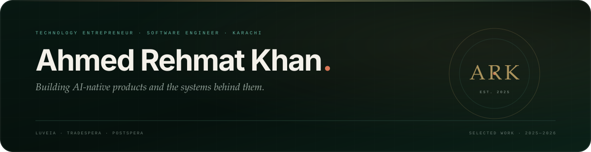

  <a href="https://ahmedrehmat.vercel.app/"><b>Portfolio</b></a> &nbsp;&#183;&nbsp;
  <a href="https://www.linkedin.com/in/ahmedrehmatkhan/"><b>LinkedIn</b></a> &nbsp;&#183;&nbsp;
  <a href="https://github.com/Ahmed-Rehmat-Khan"><b>GitHub</b></a> &nbsp;&#183;&nbsp;
  <a href="mailto:codewithahmed11@gmail.com"><b>Email</b></a>

Karachi, Pakistan &nbsp;&#183;&nbsp; Open to conversations

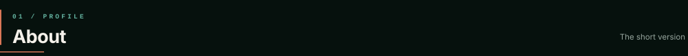

<table>
<tr>
<td width="34%" valign="top">

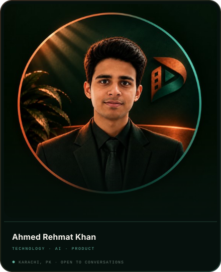

</td>
<td width="66%" valign="top">

<h3>Builder first. Operator by necessity.</h3>

I'm <b>Ahmed Rehmat Khan</b>, a 14-year-old technology entrepreneur, software engineer and product manager from <b>Karachi, Pakistan</b>.

I work across the full product lifecycle — architecture, interface, go-to-market and the operational systems that keep products alive. Find a real problem, design the system around it, then ship something people can actually use.

Today I'm CTGO at <b>Luveia</b>, Head of Product at <b>TradeSpera</b> and co-creator of <b>PostSpera</b>. I'm also going deeper into agentic AI at <b>PIAIC</b>, where I completed Agent Factory Quarter 01.

<i>Find a real problem. Design the system. Ship something people use.</i>

</td>
</tr>
</table>

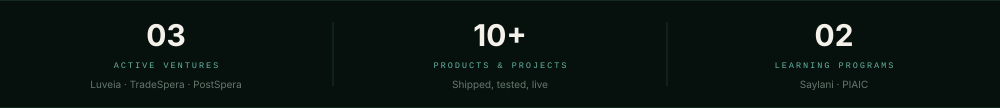

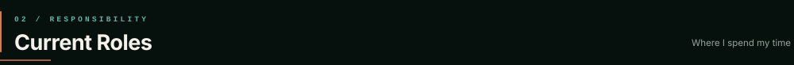

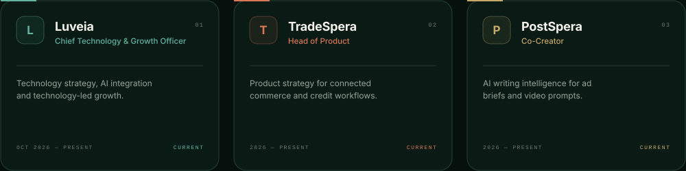

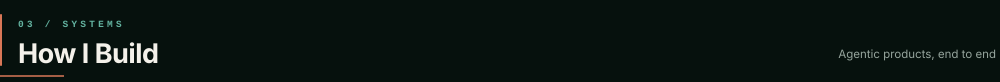

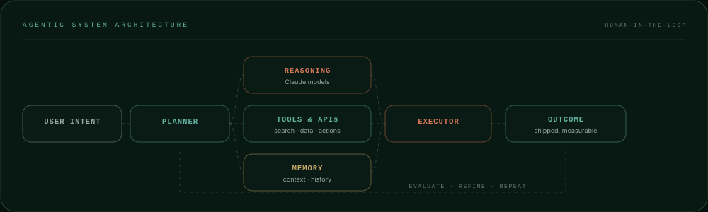

<table>
<tr>
<td width="33%" valign="top">

<b>Workflow first</b> 
Start with the job to be done, not the feature list.

</td>
<td width="33%" valign="top">

<b>Systems, not shortcuts</b> 
Design for the second, tenth and hundredth user.

</td>
<td width="33%" valign="top">

<b>Ship, measure, refine</b> 
Momentum matters. So does restraint.

</td>
</tr>
</table>

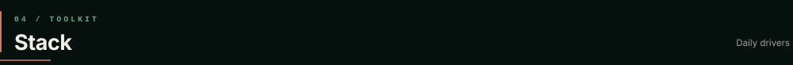

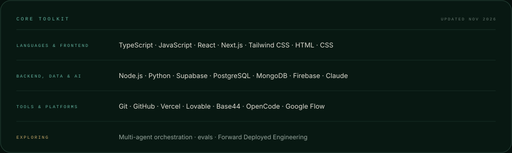

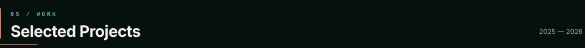

<table>
<tr>
<td width="50%" valign="top">

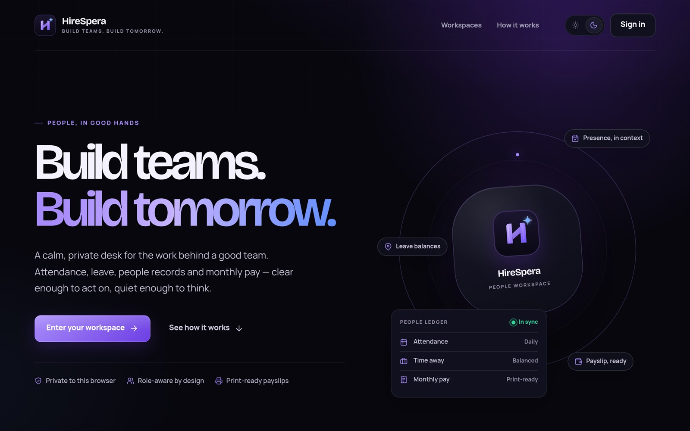
  
01 &nbsp; <b>HireSpera</b> &nbsp; LIVE
 
Recruitment and HR platform built for the Saylani HCM Lite brief during the SMIT AI Hackathon.
 
Next.js &#183; AI &#183; HR Tech

</td>
<td width="50%" valign="top">

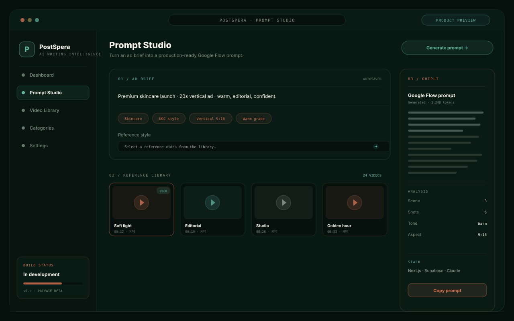
  
02 &nbsp; <b>PostSpera</b> &nbsp; IN BUILD
 
AI writing intelligence that turns ad briefs into production-ready Google Flow prompts.
 
Next.js &#183; Supabase &#183; Claude

</td>
</tr>
<tr><td colspan="2">  </td></tr>
<tr>
<td width="50%" valign="top">

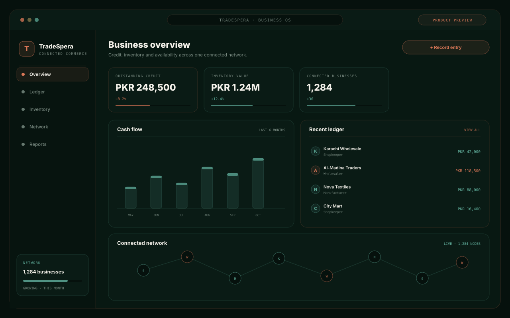
  
03 &nbsp; <b>TradeSpera</b> &nbsp; PRODUCT
 
An AI-powered business platform digitising credit, inventory and availability for connected commerce.
 
Product &#183; UX &#183; AI

</td>
<td width="50%" valign="top">

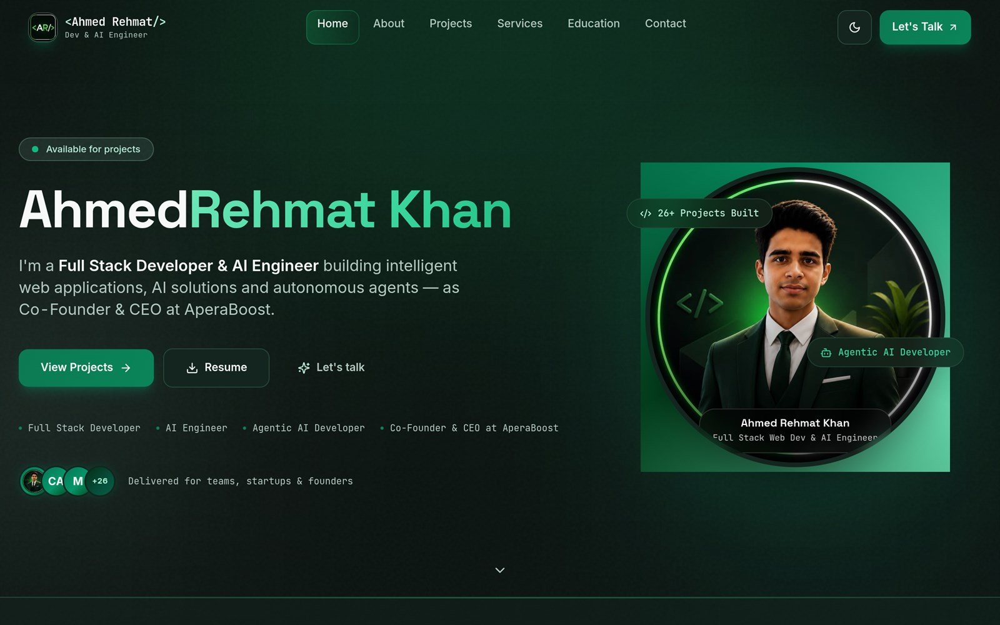
  
04 &nbsp; <b>Personal Portfolio</b> &nbsp; LIVE
 
A design-led home for the products, writing and range behind the work.
 
Next.js &#183; Design &#183; SEO

</td>
</tr>
<tr><td colspan="2">  </td></tr>
<tr>
<td width="50%" valign="top">

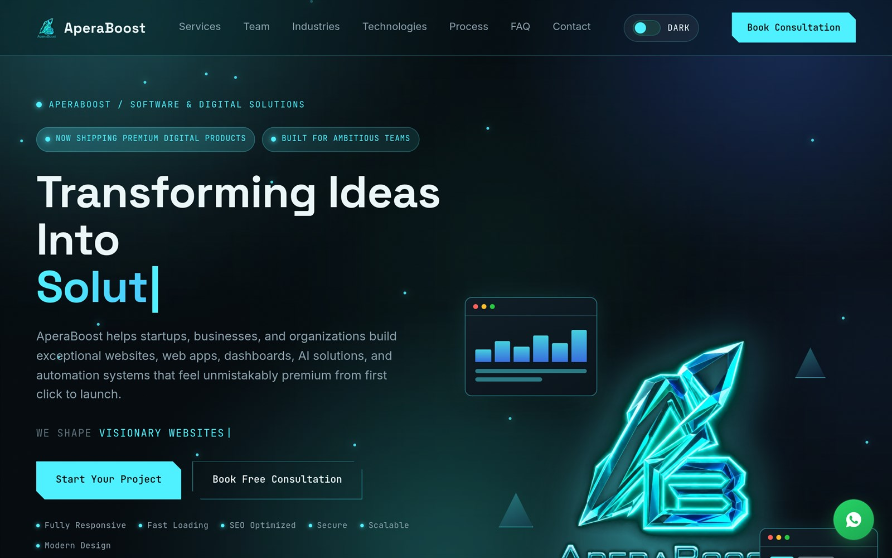
  
05 &nbsp; <b>AperaBoost</b> &nbsp; STUDIO
 
Technology startup and agency: software, AI, automation, e-commerce and growth.
 
Strategy &#183; AI &#183; Growth

</td>
<td width="50%" valign="top">

  
06 &nbsp; <b>Aura AI / AR11</b> &nbsp; CONCEPT
 
A personal AI assistant concept built around context, memory and action.
 
AI &#183; Agents &#183; Concept

</td>
</tr>
</table>

<b>Inside PostSpera — the prompt pipeline</b>

 

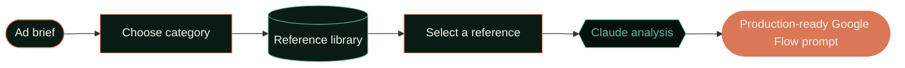

Next.js &#183; Supabase &#183; Claude Haiku &#183; metadata-based reference search &#183; on-demand analysis of the selected video.

| Project | What it is | Stage |
|:--|:--|:-:|
| **Bishoppy** | Browser-first, full-stack chess platform | In design |
| **AR-Cart** | E-commerce storefront | Prototype |
| **AR-Weather** | Weather application | Prototype |
| **ChatWithAhmed** | Personal AI chat experience | Experiment |
| **LMS** | Learning management system | Experiment |
| **Tic-Tac-Toe** | Game development | Experiment |

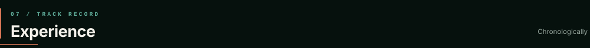

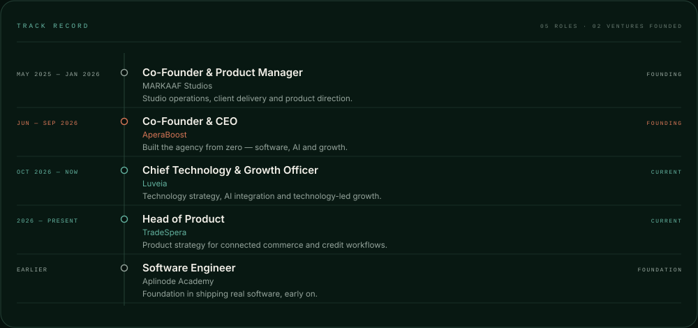

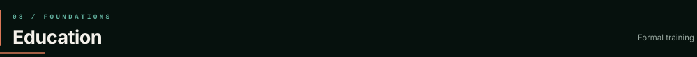

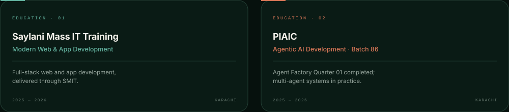

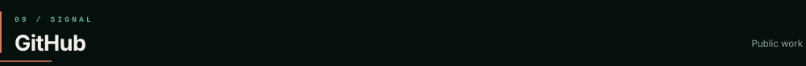

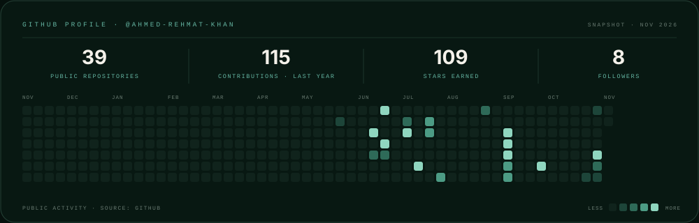

<a href="https://github.com/Ahmed-Rehmat-Khan">View profile on GitHub &nbsp;&#8594;</a>

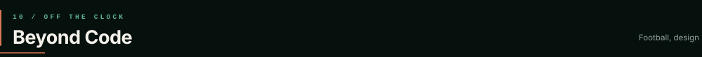

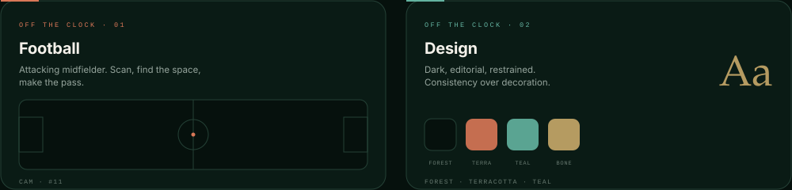

<i>Football taught me to scan before I move. Design taught me to remove before I add.</i>

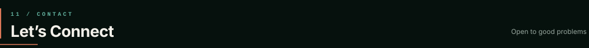

<b>Have a product in mind — or a problem worth solving?</b>

Open to conversations about AI products, SaaS, agentic systems and early-stage ideas.

<a href="mailto:codewithahmed11@gmail.com"><b>Start a conversation &nbsp;&#8594;</b></a>

  <a href="https://ahmedrehmat.vercel.app/">Portfolio</a> &nbsp;&#183;&nbsp;
  <a href="https://www.linkedin.com/in/ahmedrehmatkhan/">LinkedIn</a> &nbsp;&#183;&nbsp;
  <a href="https://github.com/Ahmed-Rehmat-Khan">GitHub</a> &nbsp;&#183;&nbsp;
  <a href="https://www.instagram.com/ahmedrehmatkhan/">Instagram</a> &nbsp;&#183;&nbsp;
  <a href="https://www.facebook.com/AhmedRehmatKhan">Facebook</a> &nbsp;&#183;&nbsp;
  <a href="mailto:codewithahmed11@gmail.com">Email</a>

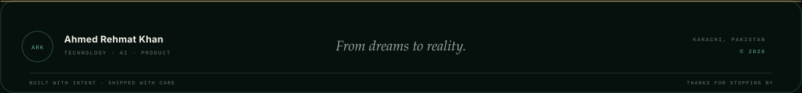
